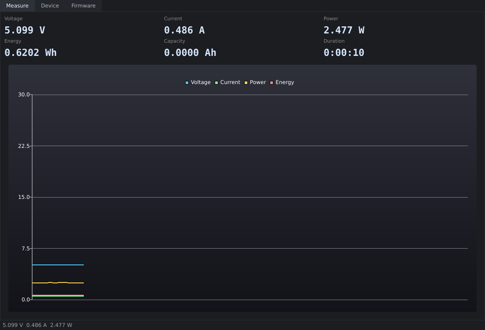

# TU13 Linux

Linux desktop application and CLI for the **ATORCH TU13** USB/Type-C tester
(VID `0483`, PID `5750`).  Built by reverse-engineering the vendor's Windows
application and verified against hardware.



## Features

- Live measurements (polled at 2 Hz): voltage, current, power, energy,
  capacity, plus a rolling chart and a session timer.
- Device information (product string, serial, mode).
- Raw HID console for protocol experiments.
- Firmware update over the native C13P bootloader protocol, from Linux.
- Detects bootloader mode and refuses to poll measurements while the device
  is in IAP mode.

## Status

| Feature | State |
|---|---|
| Voltage / current / power | verified (V x I = W checked against a load) |
| Energy / capacity | verified (energy accumulates under load) |
| Session duration | client-side counter (the device sends no time field) |
| Temperature | **not found in the measurement frame** - see docs/PROTOCOL.md |
| Settings / calibration pages | commands identified, responses not yet mapped |
| Firmware update | verified end-to-end (6270-packet flash, device rebooted) |

## Requirements

- Linux with `hidraw` (any modern kernel)
- Python 3.9+
- PySide6 (installs Qt 6 and QtCharts)
- The tester must be writable by your user - install the udev rule below

## Install

```sh
git clone https://github.com/CapnRon/tu13-linux.git
cd tu13-linux
python3 -m venv .venv
.venv/bin/pip install -e .

# allow non-root access to the HID device
sudo cp packaging/99-tu13.rules /etc/udev/rules.d/
sudo udevadm control --reload-rules && sudo udevadm trigger
```

Replug the tester after installing the rule.

## Usage

```sh
tu13                 # GUI
tu13-flash firmware.bin            # flash from bootloader mode
tu13-flash --enter-iap firmware.bin  # reboot into IAP first
```

The GUI exposes three tabs: **Measure**, **Device** (info + raw console) and
**Firmware** (file picker, progress, log).

## Firmware update

The update protocol is implemented natively and was verified by flashing the
vendor image `TU13-582-1-1-5-EN-Up.bin` to a unit stuck in its bootloader.

The bootloader writes nothing until the *entire* image has been received, and
it validates every packet, so an interrupted transfer leaves the device in
bootloader mode where a retry is possible.  Do not power off mid-transfer.

The image is sent verbatim; the bootloader handles decryption.

## Protocol

See [docs/PROTOCOL.md](docs/PROTOCOL.md) for the full HID framing, the
measurement frame layout, and the bootloader state machine.

Short version:

```
poll    55 | 05 22 05 0b 00 8c ee ff
reply   AA | 40 62 05 ...                  9 x u32 LE measurement fields
start   AA 06 <count LE16> <crc16>         bootloader session
data    CC <len> <index LE16> <58 B> <crc> one packet per chunk
ack     AA DD <len> <index LE16> ...
done    AA EE ... then AA FF ...
```

CRC is CRC-16/MODBUS (init `0xFFFF`, reflected polynomial `0xA001`).

## Known limitations

- Temperature is not present in the polled frame; the vendor app must read it
  with a command that has not been identified yet.
- Fields at offsets `0x1C`/`0x20` (decaying values) and `0x24`/`0x28`
  (constants that survive a reflash) are parsed but not shown.
- Settings/calibration writes are not implemented.

## Credits

Protocol recovered from `UsbTester.exe` 1.0.5 with Ghidra.  The vendor
application remains the reference implementation.

## License

MIT - see [LICENSE](LICENSE).
